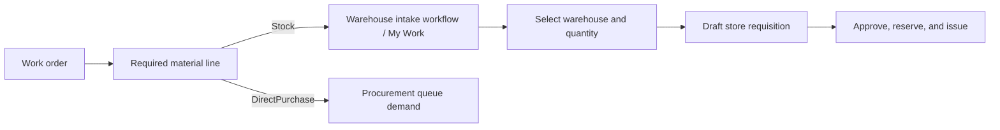

# Work-Order Warehouse Intake Audit

Scope: PEMS source at revision `a8dd5b6c`, including SCRUM-472 and its integration with SCRUM-471. The number 6 in `/Warehouse/WarehouseIntake/Details/6` is a work-order ID. Findings are based on source inspection unless stated otherwise.

## Workflow and relationships

| Relationship | Key and behavior |
| --- | --- |
| Work order → materials | One-to-many through `WorkOrderMaterial.WorkOrderId`. The work-order and material-item pair is unique. |
| Work-order material → catalog item | `MaterialItemId` points to the catalog. The unit comes from the work-order line or the catalog item. |
| Work order → intake workflow | The instance is looked up by `BusinessObjectType=WorkOrderMaterialIntake` and the work-order ID. This type distinguishes the intake workflow from the work-order lifecycle. |
| Work order → store requisition | `StoreRequisition.WorkOrderId`. Each sourcing operation creates a draft for one warehouse. Partial sourcing can create multiple drafts across warehouses. |
| Work-order material → requisition lines | `StoreRequisitionLine.WorkOrderMaterialId` is optional and supports one-to-many sourcing. Standalone requisition lines can omit it. Each requisition line records the item and requested quantity. |
| Direct-purchase material → procurement demand | `ProcurementDemand.SourceType=WorkOrderDirectPurchase` and `SourceId=WorkOrderMaterialId`. The service checks for an existing live demand from the same source before creating one. |

The process starts in Work Order Details. The request action calls the direct-purchase branch first and the warehouse branch second. The warehouse service accepts active work orders in `Assigned`, `InProgress`, or `OnHold` and requests stock lines with a positive unsourced balance. The seeded workflow stage targets warehouse manager and storekeeper roles.

The page is reachable through My Work task routing and from Work Order Details. The intake controller has no standalone list action, and the static sidebar has no dedicated Warehouse Intake entry. Store Requisitions points to `StoreRequisition/Index` and lists requisition documents.

## Quantity and authorization rules

- Sourced coverage is the sum of `ApprovedQuantity ?? RequestedQuantity` for active lines of active requisitions except rejected or cancelled ones. Unsourced stock demand is required quantity minus coverage, floored at zero.
- Drafts count toward coverage. Intake completion means demand has been covered by requisitions. Reservation, physical issue, and stock updates belong to the separate requisition lifecycle.
- Viewing details requires `StoreRequisition.View`. Sourcing requires a linked employee, `StoreRequisition.Create`, an active warehouse, an eligible work order, and a valid quantity on a stock line. The user selects the warehouse.
- Changing sourcing type from the work-order form is subject to section authorization and line-to-order validation. The code restricts changing or removing lines with live requisition links.

## Findings and proposed follow-up

| Proposed priority | Code observation | Action |
| --- | --- | --- |
| High | Remaining quantity is checked before the draft-creation transaction. The identified tests do not establish that two sessions cannot cover the same remaining demand. | Check and record coverage under one consistency boundary and add a relational-database concurrency test. |
| High | The details action checks module-level view permission. Sourcing checks create permission and an active warehouse. Neither path shows an explicit warehouse-scope or open-task check. | Agree on warehouse scope and whether sourcing outside the queue is allowed. Document the resulting authorization tests. |
| Medium | Cancellation or rejection removes requisition coverage. The workflow can complete on the last draft. Automatic reopening after rejection, cancellation, or short close was not established. | Define and test reassignment and the impact of issue shortfalls on remaining demand. |
| Medium | Stock and direct-purchase branches are called separately. A success in one branch can suppress the other branch's error. | Display both results and test partial success. |
| Medium | Users may read “sourced” as “issued,” although drafts count as sourced. | Distinguish requisition coverage from physical issue on the page. |
| Low | My Work shows Warehouse Intake, but the static sidebar does not provide a queue shortcut. | If a shortcut is needed, target the filtered intake queue in My Work. The detail page requires a work-order ID. |

## Evidence and follow-up tests

- [Intake controller](../../PEMS.Web/Areas/Warehouse/Controllers/WarehouseIntakeController.cs), [sourcing service](../../PEMS.Persistence/Servises/WarehouseIntakeService.cs), and [workflow definition](../../PEMS.Persistence/Seed/WarehouseIntakeWorkflowSeeder.cs).
- [Task links](../../PEMS.Web/Helpers/WorkflowTaskLinks.cs), [sidebar](../../PEMS.Web/Views/Shared/_SidebarMenu.cshtml), and [work-order form](../../PEMS.Web/Views/WorkOrder/Details.cshtml).
- [EF relationships](../../PEMS.Persistence/Configurations/InventoryReservationRequisitionConfigurations.cs), [procurement service](../../PEMS.Persistence/Servises/PreProcurementService.cs), and [requisition lifecycle](../../PEMS.Persistence/Servises/StoreRequisitionLifecycleService.cs).
- [Existing tests](../../PEMS.Tests/Inventory/WarehouseIntakeServiceTests.cs) cover duplicate requests, work-order status, partial sourcing across warehouses, quantities above remaining demand, permissions, and rejection of warehouse sourcing for direct-purchase lines. This report does not record a new test run or validation of deployed settings.
