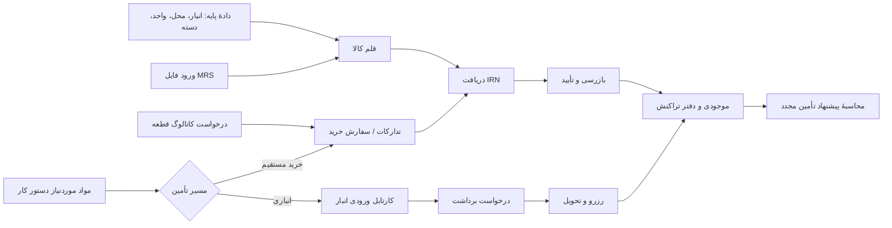
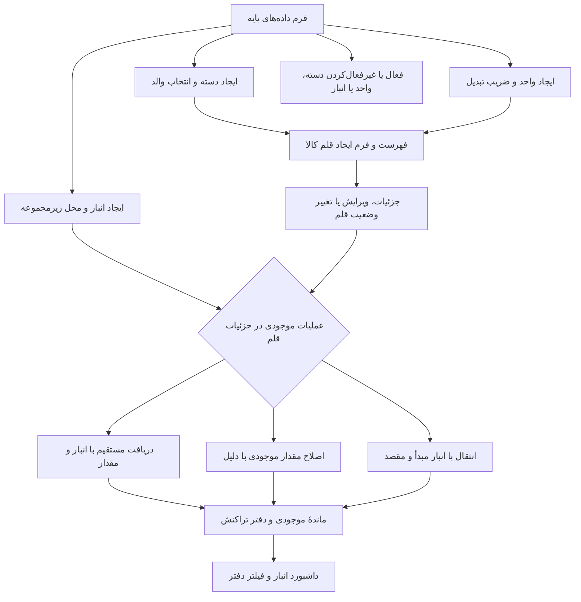
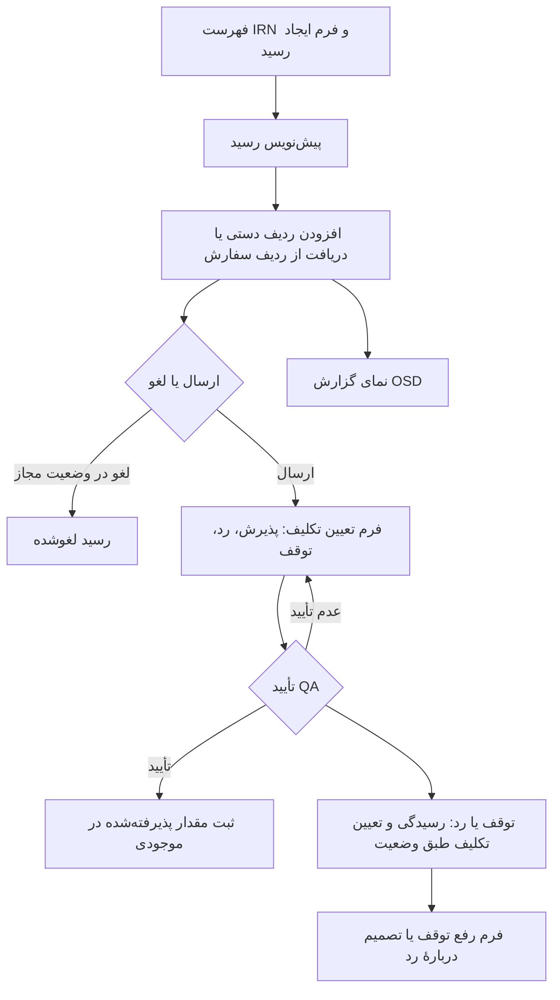
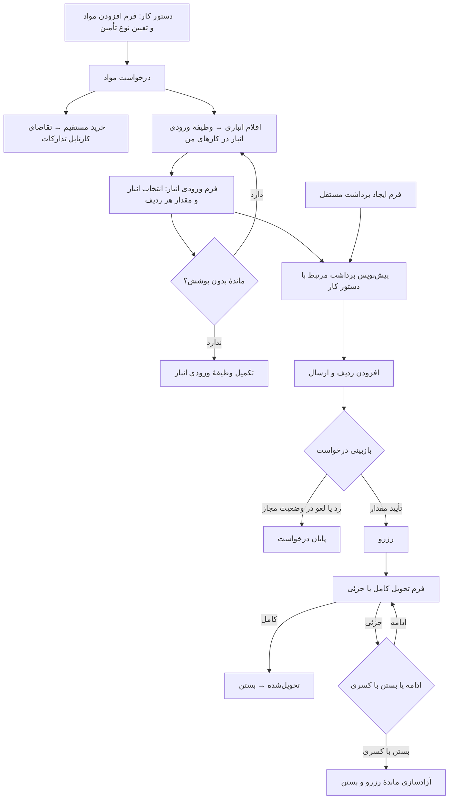
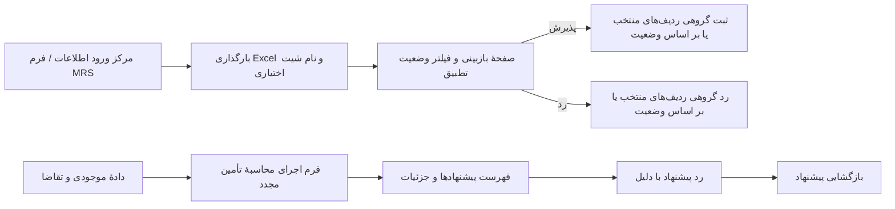
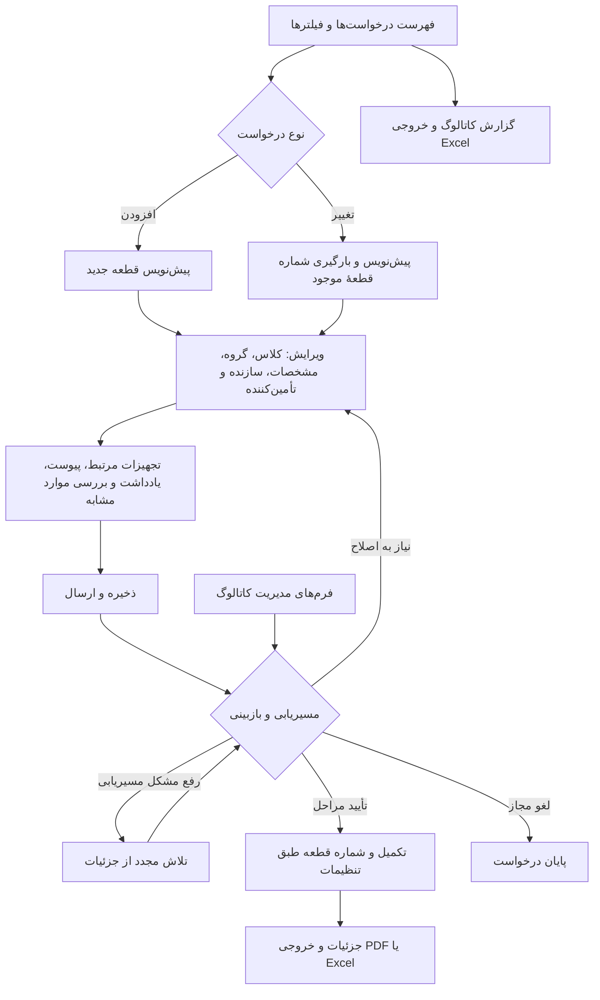

# فلو دیاگرام فرایندها و فرم‌های انبار PEMS

دامنه شامل صفحات و فرم‌های ناحیهٔ `Warehouse` و نقاط اتصال مستقیم به دستور کار، کارتابل، خرید و کنترل کیفیت است. هر نمودار یک فرایند را در اندازهٔ قابل خواندن نشان می‌دهد. مسیرهای فرم از نماها و کنترلرها استخراج شده‌اند؛ دسترسی واقعی دکمه‌ها تابع نقش، وضعیت سند و تنظیمات محیط است.

## ۱. نقشهٔ کلی

## ۲. دادهٔ پایه، قلم و عملیات موجودی

دریافت مستقیم، مسیر عملیاتی فرم قلم است. مسیر دریافت IRN و کنترل کیفیت در نمودار بعد نمایش داده شده است.

## ۳. دریافت کالا، سفارش خرید و کنترل کیفیت

## ۴. مواد دستور کار، کارتابل انبار و برداشت

تکمیل وظیفهٔ ورودی بر اساس پوشش با سند برداشت محاسبه می‌شود. تحویل فیزیکی در فرم تحویل برداشت ثبت می‌شود.

## ۵. ورود MRS و پیشنهاد تأمین مجدد

## ۶. کاتالوگ قطعه

## فهرست فرم‌ها و صفحات

مسیرها در جدول نسبت به `/Warehouse` هستند، مگر اینکه با `/` شروع شوند. فرم‌های تعبیه‌شده در صفحه با مسیر صفحهٔ میزبان آمده‌اند.

| صفحه | فرم‌ها و عملیات |
| --- | --- |
| `Inventory` | داشبورد و مرور وضعیت انبار |
| `InventoryMasterData` | ایجاد دسته، واحد، انبار و محل؛ تغییر وضعیت دسته، واحد و انبار |
| `MaterialItem` | جست‌وجو، فیلتر دسته، کمبود و بحرانی بودن؛ فرم ایجاد قلم |
| `MaterialItem/Details/{id}` | ویرایش و تغییر وضعیت؛ دریافت مستقیم، اصلاح و انتقال |
| `InventoryTransaction` | فیلتر قلم، انبار، نوع تراکنش و بازهٔ زمانی |
| `IrnReceipt` | فهرست و فیلتر وضعیت؛ فرم ایجاد رسید |
| `IrnReceipt/Details/{id}` | ردیف دریافت دستی، دریافت از سفارش، ارسال، لغو، تعیین تکلیف، تأیید، تصمیم رد و رفع توقف |
| `IrnReceipt/Osd/{id}` | نمای گزارش OSD |
| `/WorkOrder/Details/{id}` | افزودن و حذف ماده، تعیین مسیر تأمین، درخواست مواد و دسترسی به ورودی انبار |
| `WarehouseIntake/Details/{id}` | مشاهدهٔ ردیف‌ها و مراجع برداشت؛ انتخاب انبار و ثبت مقدار. شناسه متعلق به دستور کار است |
| `StoreRequisition` | فهرست و فیلتر وضعیت؛ ایجاد برداشت |
| `StoreRequisition/Details/{id}` | افزودن ردیف، گذار وضعیت، مقدار تأییدشده، تحویل، بستن با کسری، رد و لغو |
| `MrsImport` | آپلود فایل و شیت؛ فهرست بچ‌های ورود |
| `MrsImport/Review` | فیلتر تطبیق و پذیرش یا رد گروهی با انتخاب ردیف یا وضعیت |
| `Replenishment` و `Replenishment/Details/{id}` | اجرا، جست‌وجو و فیلتر پیشنهاد، جزئیات، رد و بازگشایی |
| `PartCatalogueRequest` | جست‌وجو و فیلتر، ایجاد درخواست افزودن یا تغییر |
| `PartCatalogueRequest/Edit/{id}` و `Details/{id}` | فرم ویرایش، شماره، بارگیری قطعه، تجهیزات، پیوست، یادداشت، ثبت و ارسال، تأیید/بازگشت/لغو، تلاش مجدد و خروجی |
| `PartCatalogueAdmin` | تنظیم شماره، ورود دادهٔ پایه، بخش‌ها و نگاشت گروه، تنظیم مراحل، انتساب تأییدکننده، مسئولیت و پیش‌نمایش تعیین مسئول |
| `PartCatalogueReport` | فیلتر و خروجی Excel |

سرویس‌های کمکی `PartCatalogueLookup` و `PartCatalogueDedup` فرم مستقل ندارند و جست‌وجوهای وابسته به فرم کاتالوگ را ارائه می‌کنند. برای جزئیات روابط داده و موارد نیازمند تأیید عملی، [گزارش ممیزی انبار](WAREHOUSE_RELATIONSHIPS_DATA_AUDIT.md) را ببینید.
